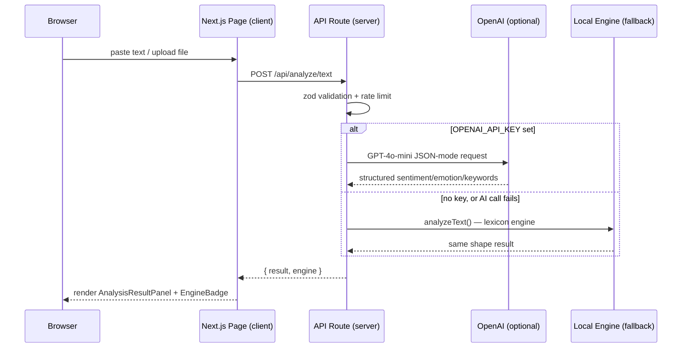

# Architecture

## Request flow for an analysis



Every AI-backed module (Text, Documents, URL, Audio, Image) follows this
same shape: validate → rate-limit → try AI if configured → fall back to a
local, deterministic implementation where one exists → always return a
result with an `engine` field so the UI can be honest about what produced
it.

## Public access — no sign-in

The app has no login. `src/lib/authz.ts` `getAuthContext()` resolves the tenant:

- a signed-in session, if one exists (legacy cookies), gets its own org;
- everyone else lands in the **shared workspace** returned by
  `resolveSharedOrg()` in `src/lib/org.ts`.

`resolveSharedOrg()` is deterministic rather than invented: it adopts the
existing workspace that already holds the most signals, and only creates a new
`default-workspace` when the database has no signals at all. So the dashboard
is never empty by accident, and no data is fabricated.

Same rule for the signals API: `src/lib/signals/auth.ts` accepts
`Authorization: Bearer <apiKey>`, then a session, then falls back to the shared
workspace.

### Auth split (Edge vs. Node)

```
src/lib/auth.config.ts   — JWT session callbacks. No Prisma, no bcrypt.
src/lib/auth.ts          — auth.config.ts + Credentials provider (bcrypt)
                            + PrismaAdapter. Node-runtime only.
                            Used by: API routes, server components
```

This split exists because Prisma Client and bcrypt both need Node APIs that
aren't available in Next.js Edge Middleware — a common Auth.js + Prisma pitfall.

## Folder structure

```
src/
  app/
    (dashboard)/        dashboard/*     — route group, shared sidebar layout
    api/
      analyze/{text,audio,image,url}   — AI-backed analysis routes
      auth/[...nextauth]               — Auth.js session + CSRF
      config/            — reports which env keys are set (booleans only)
      health/            — liveness probe
  components/
    ui/                — generic primitives (Button, GlassCard, Badge, Field, Dropzone)
    landing/            — marketing page sections
    dashboard/          — dashboard chrome + shared result panels
  lib/
    ai/openai.ts        — server-only OpenAI client (text/audio/vision)
    text-analysis.ts    — local lexicon engine (sentiment/emotion/keywords/toxicity)
    batch-analysis.ts   — CSV/Excel row-level scoring built on text-analysis.ts
    document-extract.ts — client-side PDF/DOCX text extraction
    image-analysis.ts   — client-side OCR + pixel color analysis
    auth.ts / auth.config.ts / prisma.ts / rate-limit.ts
prisma/
  schema.prisma         — full data model (not yet migrated against a live DB)
  seed.ts
```

## Data model

See `prisma/schema.prisma`. Summary: `User` (with `Account`/`Session` for
Auth.js), `Project`, `Analysis` (polymorphic across all content types via
an enum), `Report`, `Notification`, `ApiKey`, `Subscription`.
